# Visual Themes for DeepSeek Harness


Eleven hand-built, switchable visual themes for the **DeepSeek Harness** workspace. The picker lives in the left sidebar; one click restyles the whole workspace immediately, the choice survives restarts, and **Restore original** returns the app to the appearance it had before a theme was chosen.

This repository is the plugin source, the design references for every theme, and a dependency-free verification harness.

> **v1.1.0** — eleven themes, updated metadata and a GitHub-ready project. See [CHANGELOG.md](CHANGELOG.md) for the full history.

## Features

- **11 curated themes** across modern, retro desktop, glass and aqua families.
- **Compact picker** in the sidebar under *Visual themes*, with a colour swatch and name for every theme.
- **Immediate apply**; exactly one theme is active at a time.
- **Persistent selection** in both local storage and `<DSH_HOME>/visual-themes.json`, so the choice survives an app restart even when the Web GUI port changes.
- **Restore original** clears the theme, unregisters the plugin's paint and returns to the untouched host appearance.
- **Theme isolation**: colour tokens are registered through the Client `theme` service; all custom CSS is scoped under `html[data-vt]` and exists only while one of these themes is active.
- **No layout rewrites**: the composer and surrounding geometry are painted with backgrounds, radii and `box-shadow` only; the input cannot overflow its frame.
- **No runtime dependencies** and no build step.

## Design references

The images below are the design references used to build each theme. They are not live screenshots of the current app.

| | | |
|:--:|:--:|:--:|
| 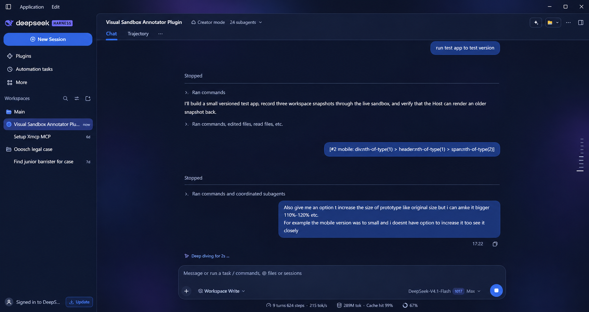<br>**Deep Space** | 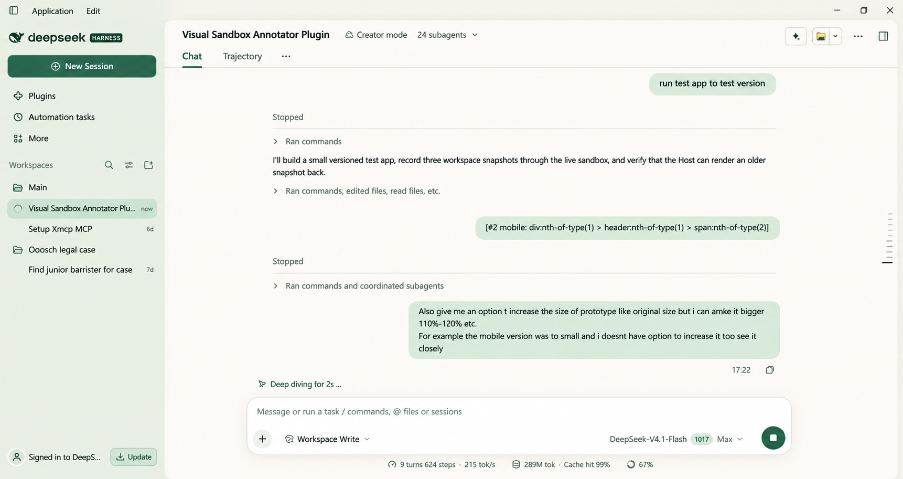<br>**Sage Studio** | 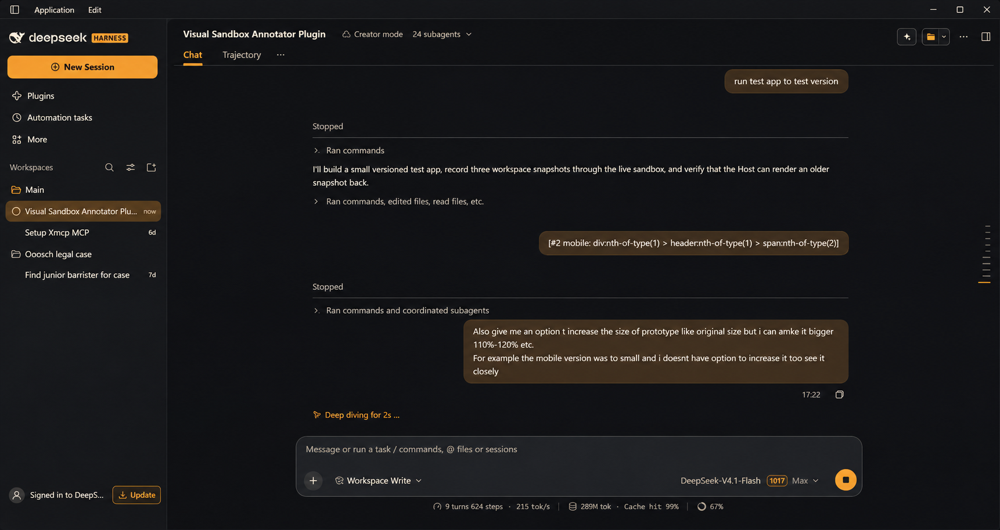<br>**Ember Terminal** |
| 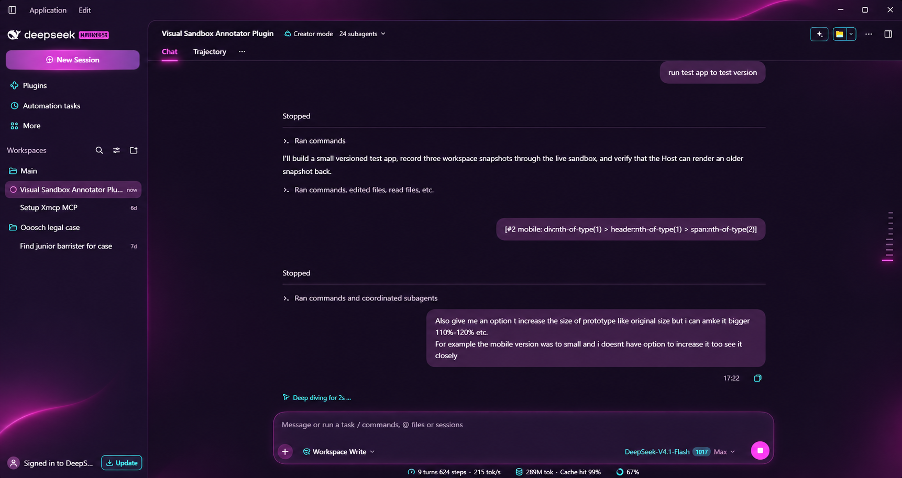<br>**Neon Pulse** | 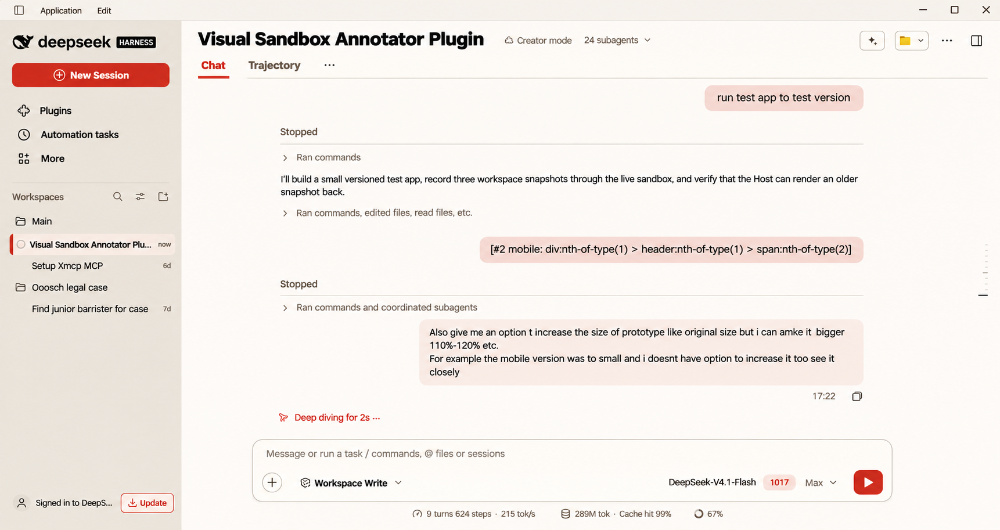<br>**Swiss Studio** | 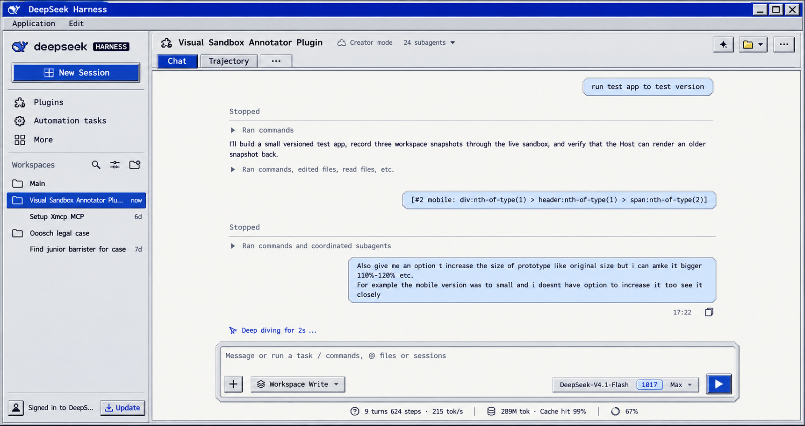<br>**Retro Desktop** |
| 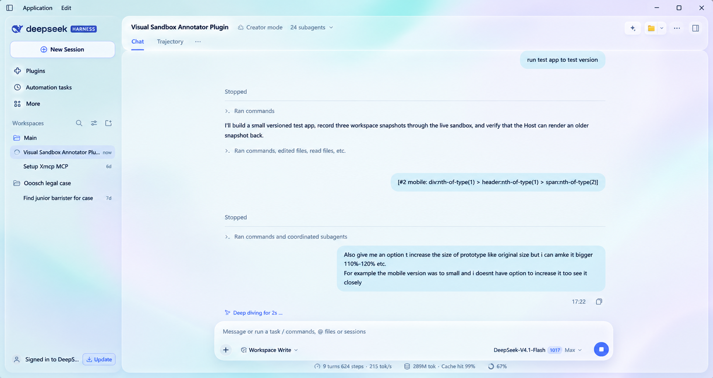<br>**Aurora Glass** | 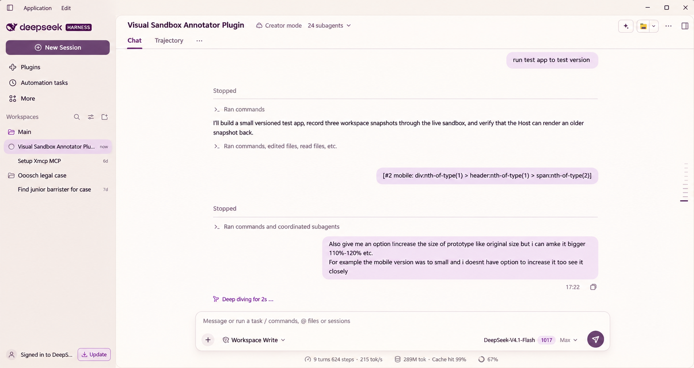<br>**Ivory & Plum** | 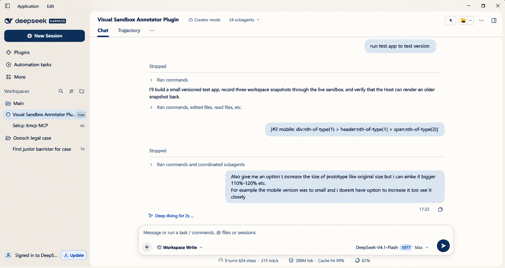<br>**Ivory & Navy** |
| 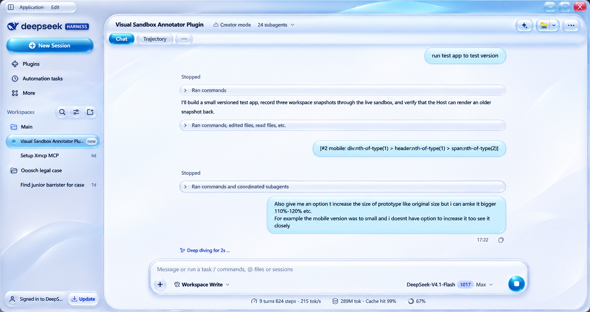<br>**Y2K Aqua** | 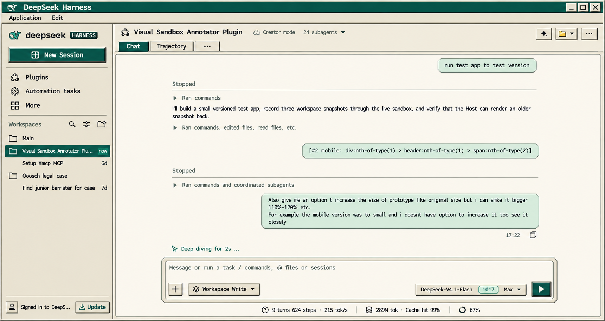<br>**Retro Mint Desktop** | |

## Themes

| # | Theme | Scheme | Character |
|---|-------|--------|-----------|
| 1 | **Deep Space** | Dark | Deep navy workspace, electric blue and violet accents |
| 2 | **Sage Studio** | Light | Warm paper surfaces, forest-green controls, calm editorial spacing |
| 3 | **Ember Terminal** | Dark | Charcoal workspace, amber accents, restrained monospaced details |
| 4 | **Neon Pulse** | Dark | Magenta/cyan night theme with controlled glow |
| 5 | **Swiss Studio** | Light | Editorial light theme, bold type, red accents, sharp square corners |
| 6 | **Retro Desktop** | Light | 1990s desktop: silver chrome, inset white client area, standalone framed tabs, chamfered outlined bubbles, double-beveled inset composer, monospaced chat |
| 7 | **Aurora Glass** | Light | Light frosted glass, periwinkle/teal accents, blurred translucent sidebar |
| 8 | **Ivory & Plum** | Light | Warm ivory workspace with plum controls and lavender bubbles |
| 9 | **Ivory & Navy** | Light | Conservative light theme with navy controls |
| 10 | **Y2K Aqua** | Light | Glossy aqua buttons, pill controls and soft gradients |
| 11 | **Retro Mint Desktop** | Light | Cream/teal 1990s desktop with chrome, a sunken client area and square raised controls |

All themes are also listed in the picker in this order, with a colour swatch preview for each.

## Requirements

- **DeepSeek Harness desktop** with the plugin manager and the Web GUI.
- A DSH profile where a local bundle can be installed.
- No Node.js, package manager or build step is required to use the plugin; the test harness only needs Node.js 18+.

The plugin targets the Client `theme`, `slots` and `locale` services and the Host `webServer` service. It is a Web client bundle (`dsh.client.platform: "web"`).

## Installation

### From the release archive (recommended)

1. Download `dsh-visual-themes-1.1.0.zip` from the [Releases](https://github.com/Surenkh/dsh-visual-themes/releases) page (or build it locally with the steps in [DEPLOY.md](DEPLOY.md)).
2. Extract it. The folder contains `package.json` at its root.
3. Install that folder as a DSH bundle:
   - **Plugin manager UI**: open **Plugins** and install a bundle from the extracted folder.
   - **Tool**:
     ```text
     plugin_manager action=install_bundle target="<absolute path to the extracted folder>"
     ```
4. Reload the Web GUI if it does not update automatically. The sidebar now shows **Visual themes**.

### From a Git checkout

```bash
git clone https://github.com/Surenkh/dsh-visual-themes.git
```

Then install the checkout folder with the plugin manager as above. The package name is `@surenkh/dsh-visual-themes`.

### Verifying the installation

1. Open **Visual themes** from the sidebar.
2. The picker shows **11 theme cards** and the currently active theme (or *Original appearance*).
3. Choose a theme — the workspace changes immediately.
4. Restart the app — the same theme is restored.
5. Choose **Restore original** — the app returns to its pre-theme appearance.

### Upgrading from 1.0.0

The 1.1.0 package is renamed to `@surenkh/dsh-visual-themes`. Remove the old bundle first:

```text
plugin_manager action=remove_bundle target=@local/dsh-visual-themes
```

Then install the new folder. A saved selection for a theme that no longer exists is ignored, and the app returns to its original appearance on the next load.

### Uninstalling

```text
plugin_manager action=remove_bundle target=@surenkh/dsh-visual-themes
```

The plugin unregisters its themes, removes its stylesheet and data attributes, and the app falls back to the host appearance. The state file under `<DSH_HOME>/visual-themes.json` is left in place; delete it if you also want to erase the saved selection.

See [INSTALL.md](INSTALL.md) for a longer walkthrough and troubleshooting.

## Usage

- **Sidebar → Visual themes**: opens the picker in the main area; the conversation stays loaded.
- Click any card to apply that theme. The active card is outlined and checked.
- **Restore original** at the bottom clears the theme and persists the cleared state.
- The picker header shows the active theme name, or *Original appearance*.
- The selection is saved automatically; there is no Apply button.

## Persistence

The selection is stored in two places and reconciled by timestamp:

1. `localStorage` key `dsh-visual-themes/state/v1` for instant restore in this GUI origin.
2. `<DSH_HOME>/visual-themes.json` through a small same-origin route:
   - `GET /visual-themes/state`
   - `POST /visual-themes/state` with `{ "theme": "<key|null>", "mode": "light|dark", "at": <epoch-ms> }`

The Host injects the stored value into the page as `window.__DSH_VISUAL_THEMES__` before the Client boots. The newer of the local and injected records wins. Only one theme can be active.

> Custom theme ids are not persisted by the host's own Settings storage; this plugin owns its persistence and restores the theme on load.

## How it works

- **Client half** (`client.js`) registers every theme through the Client `theme` service (`ctx.theme.register`). Colour tokens and the light/dark palette attribute are applied by the host presenter exactly like the built-in themes.
- **Scoped stylesheet**: a single plugin-owned `<style>` node adds what colour tokens cannot express — radii, elevation, glass blur, retro bevels, aqua gloss, typography and badge paint. Every selector is scoped under `html[data-vt]`, which the plugin sets only while one of its themes is active.
- **Sidebar + main slots**: one row is injected into `sidebar.panellist` (`id: visual-themes`, order 20) and one page into `main` (`key: visual-themes`).
- **Host half** (`index.js`) owns the state route and injects the bootstrap state. It is try/catch guarded so a missing web server cannot break the Client.
- **Restore original** clears the dataset attributes, sets the host preference back to the value it had before the theme was chosen, and persists `theme: null`.

## Project structure

```text
.
├── client.js               # Client plugin: 11 theme definitions, scoped CSS, picker, persistence
├── index.js                # Host plugin: state file + GET/POST /visual-themes/state + bootstrap injection
├── cordis.patch.yml        # Bundle patch: one sidebar/main row
├── package.json
├── icon.svg
├── locale/
│   ├── en.json
│   └── zh.json
├── test/
│   └── client.test.mjs     # dependency-free functional harness
├── assets/reference/       # design references for the 11 themes
├── README.md
├── INSTALL.md
├── CHANGELOG.md
├── LICENSE
└── DEPLOY.md
```

## Development

```bash
npm test        # loads client.js with stubbed window/document/React and asserts the full behaviour
npm run check   # syntax-check the Client and Host halves
```

The harness verifies:

- 11 theme registrations with string-valued custom-property tokens;
- the picker renders 11 cards in the documented order;
- the initial appearance is untouched until a theme is selected;
- selection, host-route persistence and the `theme/change` fallback;
- **Restore original**, disposal and removal of the stylesheet node and data attributes.

There are no dependencies; `npm install` is not required. The test uses Node's built-in `node:test`-free `assert` module.

### Adding a theme

1. Add a `theme({...})` spec in `client.js` with a unique `key`, `name`, `kind` and colour tokens.
2. Add any kind-specific paint in the scoped CSS section for that `kind`.
3. Add the reference image, theme table row and picker order entry.
4. Update the harness counts/order and the changelog; bump the version.

## Compatibility and limitations

- The plugin is a **Web client** bundle; it is designed for the DeepSeek Harness desktop Web GUI.
- The **native Windows/macOS title bar** and the OS menu are outside the page and cannot be themed. The plugin styles only the in-window app surface; native window controls remain functional.
- Theme ids are plugin-owned. The host Settings page does not persist custom ids; the plugin persists the selection itself.
- The plugin never alters the app's layout. Paint-only rules are used around the composer; no width, padding or border of the composer input is changed.
- The picker is a sidebar panel; starting a new session or changing pages does not clear the active theme.
- `prefers-reduced-motion` is respected by the host; this plugin adds no motion of its own.

## Versioning

This project follows **SemVer**:

- **1.1.0** — current: eleven themes, renamed package `@surenkh/dsh-visual-themes`, GitHub project metadata, docs, tests, design references and release artifacts.
- **1.0.0** — initial twelve-theme local bundle.

See [CHANGELOG.md](CHANGELOG.md) for details.

## Publishing

Published at **https://github.com/Surenkh/dsh-visual-themes**. Release **v1.1.0** ships the source archive and SHA-256 checksums on the [Releases](https://github.com/Surenkh/dsh-visual-themes/releases) page. [DEPLOY.md](DEPLOY.md) documents the repeatable release process.

## License

[MIT](LICENSE) © 2026 Suren Khachatryan.

## Credits

Built for **DeepSeek Harness**. Theme design references and the visual direction come from the project's own mockups, included under `assets/reference/`. The plugin uses the host's system font stack and icon sprite; no external runtime assets are loaded.
